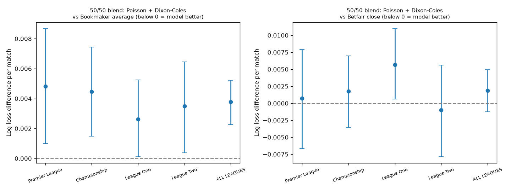

# Per-league breakdown vs the market

Round 3 models (same 6-fold walk-forward), split by league. `diff` = mean per-match log loss of model minus market; negative = model better. 95% bootstrap interval in `ci_low`/`ci_high`. A real edge needs the whole interval below zero.

## vs Bookmaker average (6 seasons, 2020/21 - 2025/26)

| league | model | model_ll | market_ll | diff | ci_low | ci_high | seasons_beating_market | n |
|---|---|---|---|---|---|---|---|---|
| Premier League | 50/50 blend: Poisson + Dixon-Coles | 0.6805 | 0.6757 | 0.0048 | 0.0010 | 0.0087 | 4/6 | 2280 |
| Premier League | Poisson + rolling Dixon-Coles features | 0.6827 | 0.6757 | 0.0071 | 0.0030 | 0.0114 | 0/6 | 2280 |
| Premier League | Poisson baseline | 0.6833 | 0.6757 | 0.0076 | 0.0036 | 0.0119 | 1/6 | 2280 |
| Championship | 50/50 blend: Poisson + Dixon-Coles | 0.6879 | 0.6834 | 0.0045 | 0.0015 | 0.0074 | 1/6 | 3312 |
| Championship | Poisson + rolling Dixon-Coles features | 0.6873 | 0.6834 | 0.0039 | 0.0011 | 0.0067 | 1/6 | 3312 |
| Championship | Poisson baseline | 0.6873 | 0.6834 | 0.0039 | 0.0008 | 0.0065 | 1/6 | 3312 |
| League One | 50/50 blend: Poisson + Dixon-Coles | 0.6882 | 0.6856 | 0.0026 | 0.0001 | 0.0052 | 1/6 | 3312 |
| League One | Poisson + rolling Dixon-Coles features | 0.6880 | 0.6856 | 0.0023 | -0.0002 | 0.0049 | 1/6 | 3312 |
| League One | Poisson baseline | 0.6881 | 0.6856 | 0.0025 | -0.0002 | 0.0052 | 1/6 | 3312 |
| League Two | 50/50 blend: Poisson + Dixon-Coles | 0.6856 | 0.6821 | 0.0035 | 0.0004 | 0.0064 | 2/6 | 3311 |
| League Two | Poisson + rolling Dixon-Coles features | 0.6859 | 0.6821 | 0.0038 | 0.0008 | 0.0065 | 2/6 | 3311 |
| League Two | Poisson baseline | 0.6865 | 0.6821 | 0.0044 | 0.0013 | 0.0073 | 2/6 | 3311 |
| ALL LEAGUES | 50/50 blend: Poisson + Dixon-Coles | 0.6860 | 0.6822 | 0.0038 | 0.0023 | 0.0052 | 0/6 | 12215 |
| ALL LEAGUES | Poisson + rolling Dixon-Coles features | 0.6863 | 0.6822 | 0.0040 | 0.0025 | 0.0056 | 0/6 | 12215 |
| ALL LEAGUES | Poisson baseline | 0.6866 | 0.6822 | 0.0043 | 0.0028 | 0.0059 | 0/6 | 12215 |

## vs Betfair close (2024/25 + 2025/26)

| league | model | model_ll | market_ll | diff | ci_low | ci_high | seasons_beating_market | n |
|---|---|---|---|---|---|---|---|---|
| Premier League | 50/50 blend: Poisson + Dixon-Coles | 0.6814 | 0.6807 | 0.0007 | -0.0066 | 0.0079 | 1/2 | 738 |
| Premier League | Poisson + rolling Dixon-Coles features | 0.6870 | 0.6807 | 0.0063 | -0.0020 | 0.0148 | 0/2 | 738 |
| Premier League | Poisson baseline | 0.6884 | 0.6807 | 0.0077 | -0.0015 | 0.0166 | 0/2 | 738 |
| Championship | 50/50 blend: Poisson + Dixon-Coles | 0.6891 | 0.6874 | 0.0018 | -0.0036 | 0.0070 | 0/2 | 1068 |
| Championship | Poisson + rolling Dixon-Coles features | 0.6906 | 0.6874 | 0.0032 | -0.0023 | 0.0087 | 0/2 | 1068 |
| Championship | Poisson baseline | 0.6915 | 0.6874 | 0.0041 | -0.0017 | 0.0098 | 0/2 | 1068 |
| League One | 50/50 blend: Poisson + Dixon-Coles | 0.6864 | 0.6807 | 0.0057 | 0.0006 | 0.0110 | 0/2 | 1071 |
| League One | Poisson + rolling Dixon-Coles features | 0.6881 | 0.6807 | 0.0074 | 0.0018 | 0.0132 | 0/2 | 1071 |
| League One | Poisson baseline | 0.6888 | 0.6807 | 0.0081 | 0.0020 | 0.0139 | 0/2 | 1071 |
| League Two | 50/50 blend: Poisson + Dixon-Coles | 0.6894 | 0.6903 | -0.0010 | -0.0079 | 0.0056 | 1/2 | 1078 |
| League Two | Poisson + rolling Dixon-Coles features | 0.6884 | 0.6903 | -0.0019 | -0.0083 | 0.0041 | 1/2 | 1078 |
| League Two | Poisson baseline | 0.6888 | 0.6903 | -0.0015 | -0.0085 | 0.0052 | 1/2 | 1078 |
| ALL LEAGUES | 50/50 blend: Poisson + Dixon-Coles | 0.6870 | 0.6851 | 0.0019 | -0.0013 | 0.0049 | 0/2 | 3955 |
| ALL LEAGUES | Poisson + rolling Dixon-Coles features | 0.6887 | 0.6851 | 0.0035 | 0.0004 | 0.0068 | 0/2 | 3955 |
| ALL LEAGUES | Poisson baseline | 0.6895 | 0.6851 | 0.0043 | 0.0010 | 0.0077 | 0/2 | 3955 |

## Detail - log loss per league and season

| league | season | n | over_rate | 50/50 blend: Poisson + Dixon-Coles | Poisson + rolling Dixon-Coles features | Poisson baseline | Bookmaker average | Betfair close |
|---|---|---|---|---|---|---|---|---|
| Championship | 2020/21 | 552 | 0.4094 | 0.6842 | 0.6836 | 0.6822 | 0.6757 |  |
| Championship | 2021/22 | 552 | 0.4674 | 0.6898 | 0.6910 | 0.6909 | 0.6870 |  |
| Championship | 2022/23 | 552 | 0.4402 | 0.6848 | 0.6839 | 0.6842 | 0.6851 |  |
| Championship | 2023/24 | 552 | 0.5217 | 0.6901 | 0.6850 | 0.6840 | 0.6827 |  |
| Championship | 2024/25 | 552 | 0.4438 | 0.6843 | 0.6872 | 0.6879 | 0.6799 | 0.6829 |
| Championship | 2025/26 | 552 | 0.5072 | 0.6942 | 0.6934 | 0.6945 | 0.6902 | 0.6921 |
| League One | 2020/21 | 552 | 0.4710 | 0.6831 | 0.6871 | 0.6879 | 0.6861 |  |
| League One | 2021/22 | 552 | 0.4909 | 0.6935 | 0.6920 | 0.6913 | 0.6888 |  |
| League One | 2022/23 | 552 | 0.4692 | 0.6943 | 0.6911 | 0.6912 | 0.6931 |  |
| League One | 2023/24 | 552 | 0.4982 | 0.6882 | 0.6840 | 0.6834 | 0.6826 |  |
| League One | 2024/25 | 552 | 0.5018 | 0.6837 | 0.6873 | 0.6880 | 0.6780 | 0.6743 |
| League One | 2025/26 | 552 | 0.5091 | 0.6865 | 0.6863 | 0.6870 | 0.6852 | 0.6875 |
| League Two | 2020/21 | 552 | 0.4257 | 0.6827 | 0.6786 | 0.6793 | 0.6757 |  |
| League Two | 2021/22 | 552 | 0.4529 | 0.6857 | 0.6851 | 0.6853 | 0.6861 |  |
| League Two | 2022/23 | 552 | 0.4130 | 0.6710 | 0.6744 | 0.6747 | 0.6748 |  |
| League Two | 2023/24 | 552 | 0.5616 | 0.6943 | 0.6998 | 0.7014 | 0.6789 |  |
| League Two | 2024/25 | 552 | 0.4565 | 0.6878 | 0.6869 | 0.6873 | 0.6869 | 0.6861 |
| League Two | 2025/26 | 552 | 0.4819 | 0.6924 | 0.6910 | 0.6913 | 0.6903 | 0.6947 |
| Premier League | 2020/21 | 380 | 0.5000 | 0.6896 | 0.6920 | 0.6902 | 0.6910 |  |
| Premier League | 2021/22 | 380 | 0.5395 | 0.6812 | 0.6858 | 0.6871 | 0.6815 |  |
| Premier League | 2022/23 | 380 | 0.5263 | 0.6757 | 0.6777 | 0.6785 | 0.6692 |  |
| Premier League | 2023/24 | 380 | 0.6474 | 0.6736 | 0.6674 | 0.6678 | 0.6477 |  |
| Premier League | 2024/25 | 380 | 0.5658 | 0.6762 | 0.6823 | 0.6837 | 0.6774 | 0.6780 |
| Premier League | 2025/26 | 380 | 0.5500 | 0.6867 | 0.6913 | 0.6925 | 0.6873 | 0.6836 |

