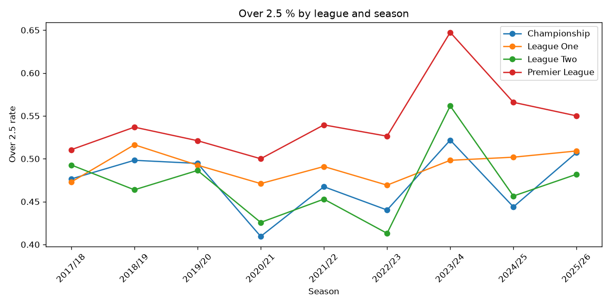
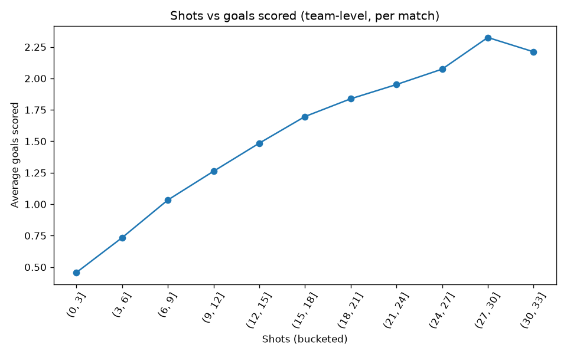
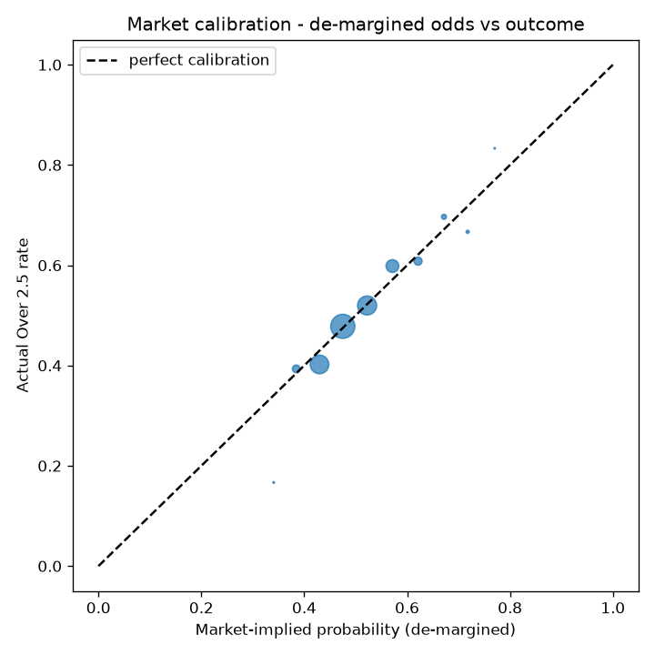

# Phase 6 - Exploratory Analysis

Generated by `src/eda.py` from `data/clean/matches_clean.csv` (18526 matches total, 18060 excluding the in-progress 2026/27 season).

## 1. Overall Over 2.5 %

**49.1%** of completed matches finish Over 2.5 goals (8,861 of 18,060).

## 2. Over 2.5 % by league and by season

### By league (all completed seasons)

| league_name | over_2_5_rate | n_matches |
|---|---|---|
| Premier League | 0.544 | 3420 |
| League One | 0.491 | 4816 |
| Championship | 0.473 | 4968 |
| League Two | 0.470 | 4856 |

### By league and season

| league_name | season | over_2_5_rate | n_matches |
|---|---|---|---|
| Championship | 2017/18 | 0.476 | 552 |
| Championship | 2018/19 | 0.498 | 552 |
| Championship | 2019/20 | 0.495 | 552 |
| Championship | 2020/21 | 0.409 | 552 |
| Championship | 2021/22 | 0.467 | 552 |
| Championship | 2022/23 | 0.440 | 552 |
| Championship | 2023/24 | 0.522 | 552 |
| Championship | 2024/25 | 0.444 | 552 |
| Championship | 2025/26 | 0.507 | 552 |
| League One | 2017/18 | 0.473 | 552 |
| League One | 2018/19 | 0.516 | 552 |
| League One | 2019/20 | 0.492 | 400 |
| League One | 2020/21 | 0.471 | 552 |
| League One | 2021/22 | 0.491 | 552 |
| League One | 2022/23 | 0.469 | 552 |
| League One | 2023/24 | 0.498 | 552 |
| League One | 2024/25 | 0.502 | 552 |
| League One | 2025/26 | 0.509 | 552 |
| League Two | 2017/18 | 0.493 | 552 |
| League Two | 2018/19 | 0.464 | 552 |
| League Two | 2019/20 | 0.486 | 440 |
| League Two | 2020/21 | 0.426 | 552 |
| League Two | 2021/22 | 0.453 | 552 |
| League Two | 2022/23 | 0.413 | 552 |
| League Two | 2023/24 | 0.562 | 552 |
| League Two | 2024/25 | 0.457 | 552 |
| League Two | 2025/26 | 0.482 | 552 |
| Premier League | 2017/18 | 0.511 | 380 |
| Premier League | 2018/19 | 0.537 | 380 |
| Premier League | 2019/20 | 0.521 | 380 |
| Premier League | 2020/21 | 0.500 | 380 |
| Premier League | 2021/22 | 0.539 | 380 |
| Premier League | 2022/23 | 0.526 | 380 |
| Premier League | 2023/24 | 0.647 | 380 |
| Premier League | 2024/25 | 0.566 | 380 |
| Premier League | 2025/26 | 0.550 | 380 |

## 3. Average goals (total, home, away) by league

| league_name | avg_total_goals | avg_home_goals | avg_away_goals |
|---|---|---|---|
| Premier League | 2.839 | 1.551 | 1.288 |
| League One | 2.609 | 1.427 | 1.181 |
| League Two | 2.549 | 1.397 | 1.151 |
| Championship | 2.538 | 1.405 | 1.133 |

## 4. Shots vs goals relationship

Per team-performance (one row per team per match), correlation of shots with goals scored: **0.300**. Shots on target with goals scored: **0.579** (expected to be higher - shots on target is a much more direct precursor to a goal than total shots).

## 5. Feature correlations and weak/redundant features

49 of 108 numeric features correlate with `over_2_5` at `|corr| < 0.03` (essentially no linear signal on their own - doesn't rule out they help in combination, but worth knowing):

| feature | corr |
|---|---|
| home_overall_shots_against_roll10 | 0.000 |
| home_venue_goals_against_roll5 | -0.000 |
| away_rest_days | -0.000 |
| home_prior_season_sot_against | -0.001 |
| home_venue_shots_against_roll5 | -0.001 |
| away_prior_season_sot_against | 0.001 |
| away_prior_season_goals_against | 0.003 |
| home_overall_goals_against_season_avg | 0.003 |
| home_overall_goals_against_roll10 | -0.003 |
| home_venue_shots_against_roll10 | 0.003 |
| home_venue_goals_against_roll10 | 0.004 |
| home_overall_shots_against_season_avg | 0.004 |
| home_season_match_num | -0.005 |
| away_season_match_num | -0.006 |
| home_blended_goals_against | -0.006 |
| home_prior_season_goals_against | -0.006 |
| home_overall_goals_against_roll5 | 0.007 |
| away_points_roll10 | 0.007 |
| away_overall_goals_against_roll5 | 0.007 |
| away_venue_goals_against_roll5 | 0.009 |
| home_venue_sot_against_roll5 | 0.009 |
| home_games_played_career | 0.009 |
| away_prior_season_shots_against | -0.010 |
| home_overall_sot_against_roll10 | 0.010 |
| home_rest_days | -0.011 |
| away_points_roll5 | 0.012 |
| eligible_for_training | 0.012 |
| home_overall_sot_against_season_avg | 0.012 |
| away_overall_goals_against_season_avg | 0.013 |
| away_venue_goals_against_roll10 | 0.013 |
| home_overall_shots_against_roll5 | 0.013 |
| home_venue_sot_against_roll10 | 0.014 |
| away_overall_goals_against_roll10 | 0.014 |
| away_blended_goals_against | 0.016 |
| away_games_played_career | 0.016 |
| home_points_roll5 | 0.017 |
| home_overall_sot_against_roll5 | 0.017 |
| home_prior_season_shots_against | -0.019 |
| away_venue_shots_against_roll5 | 0.023 |
| combined_away_goal_rate | 0.024 |
| away_venue_sot_against_roll10 | 0.024 |
| away_venue_shots_against_roll10 | 0.025 |
| away_over25_roll5 | 0.025 |
| away_venue_sot_against_roll5 | 0.025 |
| away_overall_goals_for_season_avg | 0.027 |
| home_over25_roll10 | 0.029 |
| away_overall_sot_against_season_avg | 0.029 |
| home_over25_roll5 | 0.029 |
| away_venue_goals_for_roll5 | 0.030 |

8 feature pairs correlate with each other at `|corr| > 0.9` (redundant - carrying both adds little and just inflates the feature count):

| feature_a | feature_b | corr |
|---|---|---|
| home_season_match_num | away_season_match_num | 0.998 |
| avg_under_2_5 | bfe_under_2_5 | 0.953 |
| home_over25_roll10 | home_blended_over25_rate | 0.933 |
| away_over25_roll10 | away_blended_over25_rate | 0.931 |
| avg_over_2_5 | bfe_close_over_2_5 | 0.919 |
| away_overall_goals_for_roll10 | away_blended_goals_for | 0.912 |
| league_over25_avg_to_date | league_goals_avg_to_date | 0.912 |
| avg_over_2_5 | avg_under_2_5 | -0.904 |

## 6. Unusual patterns

### COVID-affected seasons

| season | total_goals | home_win_rate |
|---|---|---|
| 2018/19 | 2.660 | 0.440 |
| 2019/20 | 2.620 | 0.435 |
| 2020/21 | 2.479 | 0.401 |
| 2021/22 | 2.605 | 0.436 |

Matches the finding already in `data_dictionary.md`: 2020/21 (fully behind closed doors) is a clear outlier on both goals and home win rate; 2019/20 (partial) barely moves; 2021/22 snaps back to normal. Confirms `behind_closed_doors` is the right place for this, not a reason to drop or adjust those seasons further.

### Early-season effect

| min_season_games_played | over_2_5_rate | n_matches |
|---|---|---|
| 0 | 0.465 | 417 |
| 1 | 0.501 | 419 |
| 2 | 0.471 | 418 |
| 3 | 0.496 | 419 |
| 4 | 0.473 | 419 |
| 5 | 0.502 | 420 |
| 6 | 0.461 | 421 |
| 7 | 0.472 | 417 |
| 8 | 0.511 | 419 |
| 9 | 0.550 | 418 |
| 10 | 0.491 | 13873 |

`min_season_games_played` is capped at 10 (games 10+ grouped together) for readability. Any step change in the early rows versus the rest would suggest an early-season effect worth a dedicated feature; a flat line says the blended/rolling features already handle it adequately.

## 7. Market calibration (de-margined odds vs actual Over rate)

13982 matches have de-margined Avg odds coverage (2019/20 onward, per `data_dictionary.md`).

| market_prob_mid | actual_rate | n |
|---|---|---|
| 0.341 | 0.167 | 24 |
| 0.384 | 0.393 | 511 |
| 0.430 | 0.402 | 3004 |
| 0.475 | 0.478 | 5021 |
| 0.522 | 0.520 | 3136 |
| 0.571 | 0.598 | 1417 |
| 0.621 | 0.608 | 559 |
| 0.672 | 0.697 | 211 |
| 0.718 | 0.667 | 81 |
| 0.770 | 0.833 | 18 |

This is Phase 7's Baseline C made visible: if the market is well calibrated (points sit close to the diagonal), that's the real bar the model needs to clear - not 50%, and not the raw league rate.
