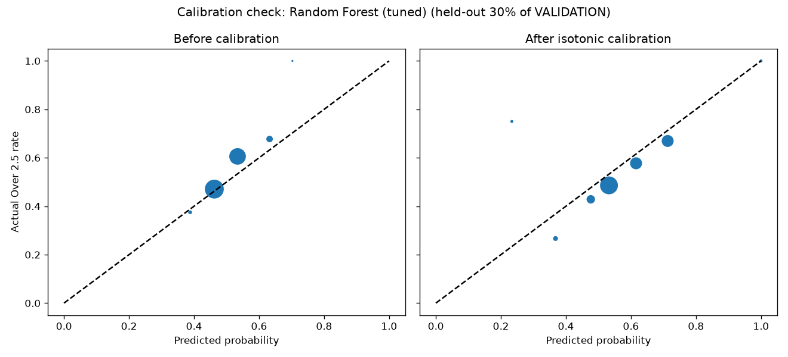

# Phase 8 - Machine Learning Models

Trained on ['2017/18', '2018/19', '2019/20', '2020/21', '2021/22', '2022/23'] (11952 matches), tuned/evaluated on ['2023/24'] (2036 matches). TEST_SEASONS ['2024/25', '2025/26'] not loaded by this script.

## Comparison (sorted by Log Loss, lower is better)

| model | log_loss | brier_score | n_matches |
|---|---|---|---|
| Baseline C - market | 0.6751 | 0.2411 | 2036 |
| Random Forest (tuned) | 0.6838 | 0.2454 | 2036 |
| Poisson Regression (fitted goals model) | 0.6856 | 0.2462 | 2036 |
| XGBoost (tuned) | 0.6859 | 0.2464 | 2036 |
| Baseline B - Poisson (rolling rate) | 0.6914 | 0.2488 | 2035 |
| Logistic Regression | 0.6914 | 0.2483 | 2036 |
| Baseline A - league rate | 0.6966 | 0.2517 | 2036 |

- Random Forest tuned over 12 (max_depth, min_samples_leaf) combinations at n_estimators=400; best: {'max_depth': None, 'min_samples_leaf': 30}.

- XGBoost tuned over 9 (max_depth, learning_rate) combinations at n_estimators=300; best: {'max_depth': 2, 'learning_rate': 0.1}.

- Poisson Regression here is a genuinely fitted model (two `PoissonRegressor`s predicting home/away goals from the engineered features), not Baseline B's rolling-average lookup - included alongside it so the comparison shows whether fitting actually helps over just using the raw rolling rate.

## Calibration check

Best non-baseline model on full validation: **Random Forest (tuned)**. Checked with a chronological 70/30 split of VALIDATION itself (fit an isotonic calibrator on the earlier 70%, check it on the later 30% - genuinely held-out, still entirely inside VALIDATION, TEST untouched):

| | Log Loss | Brier Score |
|---|---|---|
| Before calibration | 0.6785 | 0.2428 |
| After isotonic calibration | 0.6771 | 0.2425 |

**Decision: calibration adopted** - the isotonic calibrator is saved and applied to this model, per the checklist's "if needed".

**Caveat on confidence, not just the result:** the improvement here is 0.0015 in log loss, checked on only 611 held-out matches (30% of VALIDATION). That's small on both counts - per Phase 0's "never change a frozen model because of a short run" spirit, this is a weak signal, not a confident verdict. The calibrator is saved and available, but the real test is whether it still helps on Phase 9's TEST seasons (2024/25, 2025/26), on far more matches. If it doesn't, drop it rather than keep it on the strength of this one small check.

## Saved models

All in `models/`, version-tagged `_v1`: `logistic_regression_v1.joblib`, `random_forest_v1.joblib`, `poisson_home_v1.joblib`, `poisson_away_v1.joblib`, `xgboost_v1.joblib`, `calibrator_isotonic_v1.joblib`, plus `feature_scaler_v1.joblib` and `feature_medians_v1.joblib` (needed to reproduce the exact preprocessing at inference time) and `manifest.json` (hyperparameters, seasons used, feature list, full comparison table, calibration decision).
