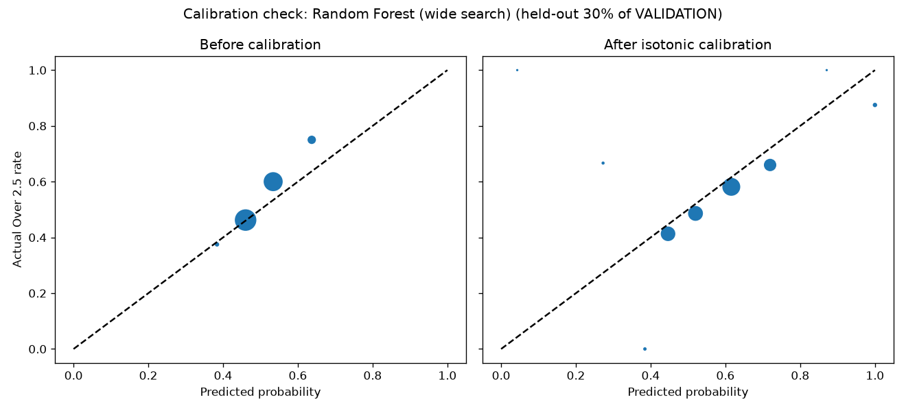

# Phase 8 (extended) - wider hyperparameter search

Supersedes the narrow grids in `reports/phase8_models.md`. Random Forest: 30 random configs. XGBoost: 25 random configs. Poisson: 25-point alpha grid. Logistic Regression: 13 C values x 2 penalties (26 configs). All scored on VALIDATION (['2023/24'], 2036 matches) only - TEST (['2024/25', '2025/26']) was not loaded by this script.

## Comparison (sorted by Log Loss, lower is better)

| model | log_loss | brier_score | n_matches |
|---|---|---|---|
| Baseline C - market | 0.6751 | 0.2411 | 2036 |
| Random Forest (wide search) | 0.6823 | 0.2446 | 2036 |
| Logistic Regression (wide search) | 0.6845 | 0.2455 | 2036 |
| XGBoost (wide search) | 0.6847 | 0.2458 | 2036 |
| Poisson Regression (wide search) | 0.6856 | 0.2462 | 2036 |
| Baseline B - Poisson (rolling rate) | 0.6914 | 0.2488 | 2035 |
| Baseline A - league rate | 0.6966 | 0.2517 | 2036 |

- Random Forest best: `{'max_depth': 15, 'max_features': 'sqrt', 'min_samples_leaf': 36, 'min_samples_split': 22, 'n_estimators': 200}`

- XGBoost best: `{'colsample_bytree': 0.62802, 'learning_rate': 0.038649, 'max_depth': 2, 'min_child_weight': 2, 'n_estimators': 300, 'reg_lambda': 2.507368, 'subsample': 0.654868}`

- Poisson Regression best alpha: `1.3335`

- Logistic Regression best: `{'C': 0.001, 'penalty': 'l2'}`

**Best candidate after the wide search: Random Forest (wide search)**

## Calibration check

Same held-out-30%-of-VALIDATION method as the narrow search: log loss before=0.6767, after=0.6950 (not adopted). Checked on 611 matches - still a small sample, same caveat as before: treat as a weak signal, confirm properly on Phase 9's test set.

## Saved models

`models/*_v2.joblib` + `models/manifest_v2.json` (v1 from the narrow search is left in place for comparison, not deleted).
