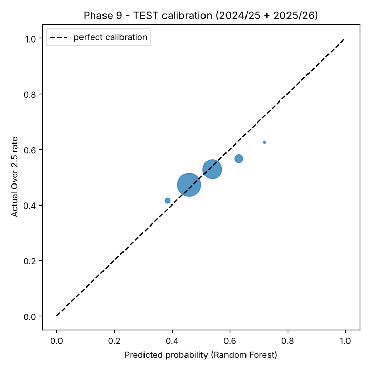
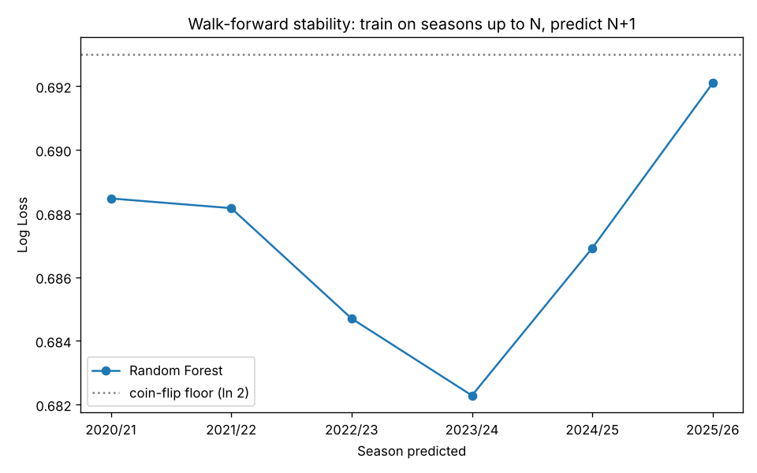

# Phase 9 - Proper Testing

**This is the one evaluation against TEST_SEASONS (['2024/25', '2025/26']) in the whole project.** Model and hyperparameters were locked before this ran (Phase 8 extended search), not tuned here.

Final model trained on TRAIN+VALIDATION combined (['2017/18', '2018/19', '2019/20', '2020/21', '2021/22', '2022/23', '2023/24'], 13988 matches): Random Forest, `{'max_depth': 15, 'max_features': 'sqrt', 'min_samples_leaf': 36, 'min_samples_split': 22, 'n_estimators': 200}`, uncalibrated.

## Overall TEST metrics

| metric | value |
|---|---|
| log_loss | 0.6897 |
| brier_score | 0.2483 |
| roc_auc | 0.5528 |
| accuracy | 0.5324 |
| precision | 0.5344 |
| recall | 0.4642 |
| f1 | 0.4968 |
| n_matches | 4072.0000 |

## vs. the market (Betfair Exchange CLOSING odds)

The real closing-price comparison the checklist asks for only becomes possible from 2024/25 onward (3955 of 4072 test matches have `bfe_close_*` coverage - see `data_dictionary.md`).

| source | log_loss | brier_score | roc_auc | accuracy | precision | recall | f1 | n_matches |
|---|---|---|---|---|---|---|---|---|
| Market (BFE closing odds) | 0.6851 | 0.2459 | 0.5748 | 0.5522 | 0.5488 | 0.5192 | 0.5336 | 3955 |
| Random Forest (same matches) | 0.6904 | 0.2486 | 0.5493 | 0.5305 | 0.5277 | 0.4582 | 0.4905 | 3955 |

**On Log Loss, the model does NOT beat the market** on the matches where both can be compared. Per Phase 0 principle 6, a win here should be treated with suspicion, not celebration, until it holds up over many more live matches - this is 3955 matches, a small sample for a market-beating claim.

## Performance by season

| season | log_loss | brier_score | roc_auc | accuracy | precision | recall | f1 | n_matches |
|---|---|---|---|---|---|---|---|---|
| 2024/25 | 0.6869 | 0.2469 | 0.5647 | 0.5462 | 0.5352 | 0.4995 | 0.5167 | 2036 |
| 2025/26 | 0.6925 | 0.2497 | 0.5419 | 0.5187 | 0.5335 | 0.4305 | 0.4765 | 2036 |

## Performance by league

| league_name | log_loss | brier_score | roc_auc | accuracy | precision | recall | f1 | n_matches |
|---|---|---|---|---|---|---|---|---|
| Championship | 0.6936 | 0.2502 | 0.5247 | 0.5091 | 0.4810 | 0.4095 | 0.4424 | 1104 |
| League One | 0.6865 | 0.2467 | 0.5896 | 0.5525 | 0.6088 | 0.3208 | 0.4202 | 1104 |
| League Two | 0.6921 | 0.2495 | 0.5197 | 0.5154 | 0.4742 | 0.3012 | 0.3684 | 1104 |
| Premier League | 0.6855 | 0.2462 | 0.5347 | 0.5618 | 0.5660 | 0.9198 | 0.7008 | 760 |

## Calibration - the most important question

**When the model says 70-75%, do roughly 70-75% of those matches actually go Over?** The table below is the direct answer, bucket by bucket:

| bucket | pred_mid | actual_rate | n |
|---|---|---|---|
| 0.3-0.4 | 0.3839 | 0.4144 | 111 |
| 0.4-0.5 | 0.4592 | 0.4718 | 2202 |
| 0.5-0.6 | 0.5396 | 0.5276 | 1469 |
| 0.6-0.7 | 0.6313 | 0.5657 | 274 |
| 0.7-0.8 | 0.7208 | 0.6250 | 16 |

## Walk-forward validation (stability across seasons)

Same locked hyperparameters throughout - only the training window grows. Shows whether performance is consistently close to the market or swings wildly season to season (a swing would suggest luck, not skill).

| train_through | predicts | log_loss | brier_score | roc_auc | n_matches |
|---|---|---|---|---|---|
| 2019/20 | 2020/21 | 0.6885 | 0.2477 | 0.5441 | 2036 |
| 2020/21 | 2021/22 | 0.6882 | 0.2475 | 0.5557 | 2036 |
| 2021/22 | 2022/23 | 0.6847 | 0.2458 | 0.5508 | 2036 |
| 2022/23 | 2023/24 | 0.6823 | 0.2446 | 0.5990 | 2036 |
| 2023/24 | 2024/25 | 0.6869 | 0.2469 | 0.5647 | 2036 |
| 2024/25 | 2025/26 | 0.6921 | 0.2495 | 0.5468 | 2036 |

## Saved

`models/random_forest_phase9_test.joblib` (the exact model evaluated above) + `models/phase9_test_results.json` (every number in this report, machine-readable).
