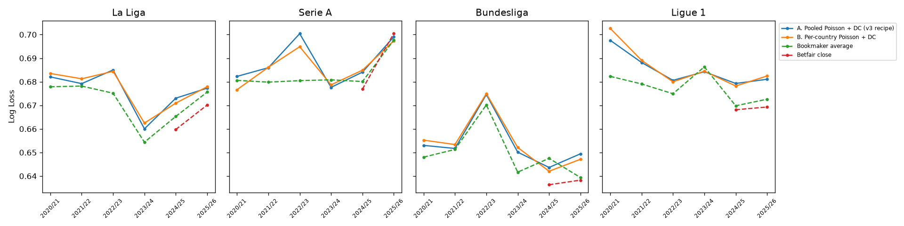

# v3-eu-upper backtest - La Liga, Serie A, Bundesliga, Ligue 1

v3 recipe (Poisson alpha 1.3335 + per-league Dixon-Coles, 50/50), pooled vs per-country. 6-fold walk-forward. `diff` < 0 = model better; 95% bootstrap interval.

## vs Bookmaker average

| league | model | model_ll | market_ll | diff | ci_low | ci_high | seasons_beating_market | n |
|---|---|---|---|---|---|---|---|---|
| ALL | A. Pooled Poisson + DC (v3 recipe) | 0.6768 | 0.6713 | 0.0055 | 0.0034 | 0.0076 | 0/6 | 8452 |
| ALL | B. Per-country Poisson + DC | 0.6768 | 0.6713 | 0.0055 | 0.0032 | 0.0078 | 0/6 | 8452 |
| ALL | C. Pooled Poisson alone | 0.6775 | 0.6713 | 0.0063 | 0.0042 | 0.0083 | 0/6 | 8452 |
| ALL | D. Dixon-Coles alone | 0.6834 | 0.6713 | 0.0121 | 0.0089 | 0.0152 | 0/6 | 8452 |
| La Liga | A. Pooled Poisson + DC (v3 recipe) | 0.6761 | 0.6711 | 0.0050 | 0.0010 | 0.0091 | 0/6 | 2280 |
| La Liga | B. Per-country Poisson + DC | 0.6767 | 0.6711 | 0.0057 | 0.0014 | 0.0100 | 0/6 | 2280 |
| La Liga | C. Pooled Poisson alone | 0.6765 | 0.6711 | 0.0054 | 0.0014 | 0.0097 | 2/6 | 2280 |
| La Liga | D. Dixon-Coles alone | 0.6841 | 0.6711 | 0.0131 | 0.0066 | 0.0196 | 0/6 | 2280 |
| Serie A | A. Pooled Poisson + DC (v3 recipe) | 0.6882 | 0.6832 | 0.0050 | 0.0012 | 0.0088 | 1/6 | 2278 |
| Serie A | B. Per-country Poisson + DC | 0.6864 | 0.6832 | 0.0032 | -0.0007 | 0.0072 | 3/6 | 2278 |
| Serie A | C. Pooled Poisson alone | 0.6886 | 0.6832 | 0.0054 | 0.0015 | 0.0094 | 1/6 | 2278 |
| Serie A | D. Dixon-Coles alone | 0.6943 | 0.6832 | 0.0110 | 0.0046 | 0.0171 | 2/6 | 2278 |
| Bundesliga | A. Pooled Poisson + DC (v3 recipe) | 0.6537 | 0.6497 | 0.0041 | -0.0005 | 0.0087 | 1/6 | 1836 |
| Bundesliga | B. Per-country Poisson + DC | 0.6541 | 0.6497 | 0.0045 | -0.0007 | 0.0097 | 1/6 | 1836 |
| Bundesliga | C. Pooled Poisson alone | 0.6564 | 0.6497 | 0.0067 | 0.0017 | 0.0117 | 0/6 | 1836 |
| Bundesliga | D. Dixon-Coles alone | 0.6581 | 0.6497 | 0.0085 | 0.0008 | 0.0155 | 1/6 | 1836 |
| Ligue 1 | A. Pooled Poisson + DC (v3 recipe) | 0.6855 | 0.6776 | 0.0079 | 0.0037 | 0.0118 | 1/6 | 2058 |
| Ligue 1 | B. Per-country Poisson + DC | 0.6866 | 0.6776 | 0.0090 | 0.0046 | 0.0135 | 1/6 | 2058 |
| Ligue 1 | C. Pooled Poisson alone | 0.6854 | 0.6776 | 0.0077 | 0.0036 | 0.0116 | 0/6 | 2058 |
| Ligue 1 | D. Dixon-Coles alone | 0.6930 | 0.6776 | 0.0154 | 0.0086 | 0.0222 | 0/6 | 2058 |

## vs Betfair close

| league | model | model_ll | market_ll | diff | ci_low | ci_high | seasons_beating_market | n |
|---|---|---|---|---|---|---|---|---|
| ALL | A. Pooled Poisson + DC (v3 recipe) | 0.6747 | 0.6660 | 0.0086 | 0.0043 | 0.0131 | 0/2 | 2655 |
| ALL | B. Per-country Poisson + DC | 0.6740 | 0.6660 | 0.0080 | 0.0036 | 0.0124 | 0/2 | 2655 |
| ALL | C. Pooled Poisson alone | 0.6740 | 0.6660 | 0.0080 | 0.0039 | 0.0123 | 0/2 | 2655 |
| ALL | D. Dixon-Coles alone | 0.6823 | 0.6660 | 0.0163 | 0.0099 | 0.0232 | 0/2 | 2655 |
| La Liga | A. Pooled Poisson + DC (v3 recipe) | 0.6746 | 0.6647 | 0.0099 | 0.0008 | 0.0186 | 0/2 | 729 |
| La Liga | B. Per-country Poisson + DC | 0.6737 | 0.6647 | 0.0089 | -0.0001 | 0.0178 | 0/2 | 729 |
| La Liga | C. Pooled Poisson alone | 0.6724 | 0.6647 | 0.0076 | -0.0015 | 0.0167 | 0/2 | 729 |
| La Liga | D. Dixon-Coles alone | 0.6850 | 0.6647 | 0.0202 | 0.0079 | 0.0335 | 0/2 | 729 |
| Serie A | A. Pooled Poisson + DC (v3 recipe) | 0.6915 | 0.6884 | 0.0032 | -0.0047 | 0.0106 | 1/2 | 739 |
| Serie A | B. Per-country Poisson + DC | 0.6912 | 0.6884 | 0.0029 | -0.0047 | 0.0106 | 1/2 | 739 |
| Serie A | C. Pooled Poisson alone | 0.6899 | 0.6884 | 0.0015 | -0.0058 | 0.0084 | 1/2 | 739 |
| Serie A | D. Dixon-Coles alone | 0.6991 | 0.6884 | 0.0107 | -0.0006 | 0.0219 | 0/2 | 739 |
| Bundesliga | A. Pooled Poisson + DC (v3 recipe) | 0.6466 | 0.6373 | 0.0093 | -0.0003 | 0.0190 | 0/2 | 594 |
| Bundesliga | B. Per-country Poisson + DC | 0.6448 | 0.6373 | 0.0076 | -0.0021 | 0.0173 | 0/2 | 594 |
| Bundesliga | C. Pooled Poisson alone | 0.6484 | 0.6373 | 0.0111 | 0.0023 | 0.0202 | 0/2 | 594 |
| Bundesliga | D. Dixon-Coles alone | 0.6528 | 0.6373 | 0.0155 | 0.0011 | 0.0292 | 0/2 | 594 |
| Ligue 1 | A. Pooled Poisson + DC (v3 recipe) | 0.6820 | 0.6687 | 0.0133 | 0.0036 | 0.0220 | 0/2 | 593 |
| Ligue 1 | B. Per-country Poisson + DC | 0.6822 | 0.6687 | 0.0135 | 0.0046 | 0.0226 | 0/2 | 593 |
| Ligue 1 | C. Pooled Poisson alone | 0.6821 | 0.6687 | 0.0134 | 0.0053 | 0.0215 | 0/2 | 593 |
| Ligue 1 | D. Dixon-Coles alone | 0.6877 | 0.6687 | 0.0190 | 0.0051 | 0.0325 | 0/2 | 593 |

## Detail - log loss per league and season

| league | season | n | A. Pooled Poisson + DC (v3 recipe) | B. Per-country Poisson + DC | C. Pooled Poisson alone | D. Dixon-Coles alone | Bookmaker average | Betfair close |
|---|---|---|---|---|---|---|---|---|
| Bundesliga | 2020/21 | 306 | 0.6530 | 0.6552 | 0.6527 | 0.6600 | 0.6480 |  |
| Bundesliga | 2021/22 | 306 | 0.6517 | 0.6534 | 0.6588 | 0.6537 | 0.6513 |  |
| Bundesliga | 2022/23 | 306 | 0.6746 | 0.6750 | 0.6771 | 0.6759 | 0.6702 |  |
| Bundesliga | 2023/24 | 306 | 0.6501 | 0.6521 | 0.6549 | 0.6519 | 0.6417 |  |
| Bundesliga | 2024/25 | 306 | 0.6436 | 0.6420 | 0.6541 | 0.6419 | 0.6475 | 0.6363 |
| Bundesliga | 2025/26 | 306 | 0.6494 | 0.6471 | 0.6408 | 0.6653 | 0.6394 | 0.6383 |
| La Liga | 2020/21 | 380 | 0.6820 | 0.6835 | 0.6806 | 0.6924 | 0.6779 |  |
| La Liga | 2021/22 | 380 | 0.6792 | 0.6813 | 0.6770 | 0.6878 | 0.6782 |  |
| La Liga | 2022/23 | 380 | 0.6850 | 0.6844 | 0.6817 | 0.6960 | 0.6751 |  |
| La Liga | 2023/24 | 380 | 0.6600 | 0.6625 | 0.6735 | 0.6579 | 0.6544 |  |
| La Liga | 2024/25 | 380 | 0.6730 | 0.6709 | 0.6737 | 0.6785 | 0.6653 | 0.6597 |
| La Liga | 2025/26 | 380 | 0.6773 | 0.6779 | 0.6726 | 0.6922 | 0.6756 | 0.6701 |
| Ligue 1 | 2020/21 | 380 | 0.6976 | 0.7026 | 0.6935 | 0.7117 | 0.6823 |  |
| Ligue 1 | 2021/22 | 380 | 0.6882 | 0.6891 | 0.6860 | 0.6977 | 0.6791 |  |
| Ligue 1 | 2022/23 | 380 | 0.6806 | 0.6800 | 0.6820 | 0.6865 | 0.6749 |  |
| Ligue 1 | 2023/24 | 306 | 0.6842 | 0.6845 | 0.6885 | 0.6866 | 0.6863 |  |
| Ligue 1 | 2024/25 | 306 | 0.6793 | 0.6782 | 0.6782 | 0.6860 | 0.6698 | 0.6681 |
| Ligue 1 | 2025/26 | 306 | 0.6811 | 0.6824 | 0.6827 | 0.6853 | 0.6726 | 0.6693 |
| Serie A | 2020/21 | 380 | 0.6823 | 0.6766 | 0.6956 | 0.6782 | 0.6806 |  |
| Serie A | 2021/22 | 380 | 0.6859 | 0.6861 | 0.6840 | 0.6948 | 0.6798 |  |
| Serie A | 2022/23 | 380 | 0.7004 | 0.6949 | 0.6917 | 0.7144 | 0.6805 |  |
| Serie A | 2023/24 | 380 | 0.6776 | 0.6787 | 0.6813 | 0.6790 | 0.6808 |  |
| Serie A | 2024/25 | 380 | 0.6841 | 0.6849 | 0.6853 | 0.6879 | 0.6801 | 0.6769 |
| Serie A | 2025/26 | 380 | 0.6990 | 0.6974 | 0.6937 | 0.7111 | 0.6976 | 0.7005 |

**Best overall: A. Pooled Poisson + DC (v3 recipe)** (0.6768 vs bookmaker 0.6713).

