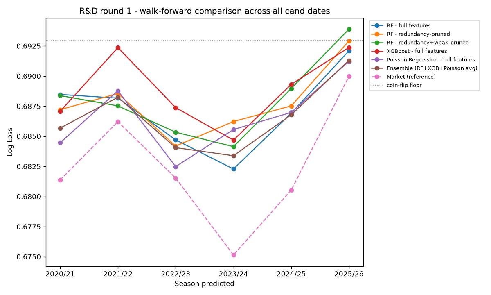

# R&D round 1

Judged by walk-forward log loss averaged across 6 folds (predicting 2020/21 through 2025/26 in turn, training on everything before each one) - not a single validation season, specifically to avoid repeating the mistake Phase 9's walk-forward chart exposed. Hyperparameters fixed at Phase 8's values throughout, so any difference here is attributable to the idea being tested (feature pruning, ensembling), not to searching harder.

Feature pruning: 103 engineered features -> 99 after dropping redundant pairs (|corr| > 0.9, recomputed fresh over all historical data) -> 52 after also dropping weak features (|corr with target| < 0.03).

## Summary (sorted by mean Log Loss across folds, lower is better)

| candidate | mean_log_loss | std_log_loss | mean_brier | n_folds |
|---|---|---|---|---|
| Market (reference) | 0.6825 | 0.0051 | 0.2447 | 6 |
| Ensemble (RF+XGB+Poisson avg) | 0.6866 | 0.0029 | 0.2467 | 6 |
| Poisson Regression - full features | 0.6866 | 0.0031 | 0.2467 | 6 |
| RF - full features | 0.6871 | 0.0034 | 0.2470 | 6 |
| RF - redundancy-pruned | 0.6878 | 0.0029 | 0.2473 | 6 |
| RF - redundancy+weak-pruned | 0.6880 | 0.0034 | 0.2475 | 6 |
| XGBoost - full features | 0.6889 | 0.0031 | 0.2478 | 6 |

## Fold-by-fold detail

| predicts | Ensemble (RF+XGB+Poisson avg) | Market (reference) | Poisson Regression - full features | RF - full features | RF - redundancy+weak-pruned | RF - redundancy-pruned | XGBoost - full features |
|---|---|---|---|---|---|---|---|
| 2020/21 | 0.6857 | 0.6814 | 0.6845 | 0.6885 | 0.6884 | 0.6872 | 0.6871 |
| 2021/22 | 0.6882 | 0.6862 | 0.6888 | 0.6882 | 0.6875 | 0.6886 | 0.6924 |
| 2022/23 | 0.6841 | 0.6815 | 0.6825 | 0.6847 | 0.6853 | 0.6842 | 0.6874 |
| 2023/24 | 0.6834 | 0.6751 | 0.6856 | 0.6823 | 0.6841 | 0.6862 | 0.6847 |
| 2024/25 | 0.6868 | 0.6805 | 0.6870 | 0.6869 | 0.6890 | 0.6875 | 0.6893 |
| 2025/26 | 0.6913 | 0.6900 | 0.6912 | 0.6921 | 0.6939 | 0.6929 | 0.6924 |

**Best model candidate: Ensemble (RF+XGB+Poisson avg)** (mean log loss 0.6866 vs market's 0.6825 across the same folds - does NOT beat the market).

**This is still not proof of a live edge.** Every number above comes from historical data already used in Phase 9 - it tells us which approach generalizes best across past seasons, which is a much better signal than a single validation season, but it is still not out-of-sample in the way that matters for staking real money. Whatever candidate is chosen from this round needs to be frozen, unchanged, and proven against 2026/27 as it's actually played before any bet is placed on it.
