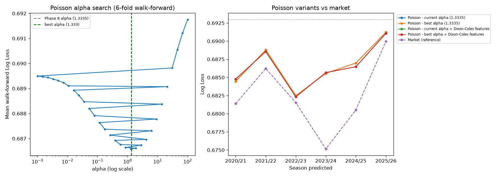

# R&D round 2 - pushing on Poisson Regression

Same evaluation method as round 1: mean Log Loss across 6 walk-forward folds (predicting 2020/21 through 2025/26 in turn). Two ideas tested on top of the existing Poisson model: a much wider alpha search (scored on the walk-forward mean, not one validation season), and Dixon-Coles-style attack/defense ratings as extra features (fit per fold on that fold's training matches only, then held frozen for the whole test season - no leakage, but a simplified Dixon-Coles with no time-decay weighting).

## Alpha search (31 values tried)

| alpha | mean_log_loss | std_log_loss |
|---|---|---|
| 1.3335 | 0.6866 | 0.0031 |
| 1.2690 | 0.6866 | 0.0031 |
| 1.8874 | 0.6866 | 0.0031 |
| 0.8532 | 0.6866 | 0.0032 |
| 2.8072 | 0.6867 | 0.0030 |
| 0.5736 | 0.6868 | 0.0032 |
| 0.3857 | 0.6869 | 0.0033 |
| 4.1753 | 0.6870 | 0.0029 |
| 0.2593 | 0.6871 | 0.0034 |
| 6.2102 | 0.6873 | 0.0028 |

Best alpha: **1.3335** vs Phase 8's **1.3335**.

## Comparison with Dixon-Coles features

| candidate | mean_log_loss | std_log_loss | mean_brier | n_folds |
|---|---|---|---|---|
| Market (reference) | 0.6825 | 0.0051 | 0.2447 | 6 |
| Poisson - best alpha + Dixon-Coles features | 0.6865 | 0.0030 | 0.2467 | 6 |
| Poisson - current alpha + Dixon-Coles features | 0.6865 | 0.0030 | 0.2467 | 6 |
| Poisson - best alpha (1.3335) | 0.6866 | 0.0031 | 0.2467 | 6 |
| Poisson - current alpha (1.3335) | 0.6866 | 0.0031 | 0.2467 | 6 |

**Best: Poisson - best alpha + Dixon-Coles features** (mean log loss 0.6865 vs market's 0.6825 - does NOT beat the market).

Still historical data, still not proof of a live edge - same caveat as round 1. Whatever is picked from this needs to be frozen and proven against 2026/27 as it's actually played before any money follows it.
