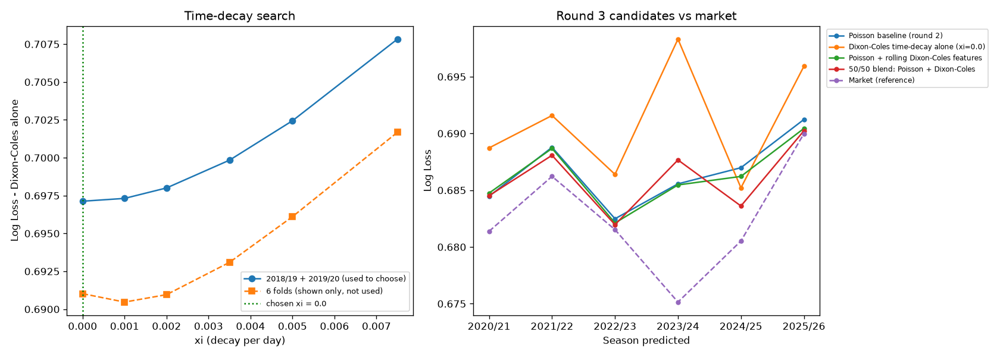

# R&D round 3 - Dixon-Coles with time decay (rolling, weekly re-fit)

Round 2's Dixon-Coles ratings were fitted once per fold and used in-sample on the training matches, then held frozen for the whole test season. Round 3 re-fits every week on matches strictly before that week (last 3 years, weighted exp(-xi * days_ago)), with the rho low-score correction, so every match - training and test - gets a rating that is genuinely out-of-sample, exactly as the live pipeline would produce it.

## Choosing xi (on 2018/19 + 2019/20 only - not on the folds)

| xi | half_life_days | selection_log_loss | selection_n | fold_mean_log_loss_info_only |
|---|---|---|---|---|
| 0.0000 |  | 0.6971 | 3808 | 0.6910 |
| 0.0010 | 693.1472 | 0.6973 | 3808 | 0.6905 |
| 0.0020 | 346.5736 | 0.6980 | 3808 | 0.6910 |
| 0.0035 | 198.0421 | 0.6998 | 3808 | 0.6931 |
| 0.0050 | 138.6294 | 0.7024 | 3808 | 0.6961 |
| 0.0075 | 92.4196 | 0.7078 | 3808 | 0.7017 |

Chosen xi: **0.0** (no decay).

## Walk-forward comparison (6 folds, 2020/21 - 2025/26)

| candidate | mean_log_loss | std_log_loss | mean_ll_on_market_matches | mean_brier | n_folds | folds_beating_market |
|---|---|---|---|---|---|---|
| Market (reference) | 0.6825 | 0.0051 | 0.6825 | 0.2447 | 6 | 0 |
| 50/50 blend: Poisson + Dixon-Coles | 0.6860 | 0.0031 | 0.6861 | 0.2464 | 6 | 0 |
| Poisson + rolling Dixon-Coles features | 0.6863 | 0.0029 | 0.6864 | 0.2466 | 6 | 0 |
| Poisson baseline (round 2) | 0.6866 | 0.0031 | 0.6867 | 0.2467 | 6 | 0 |
| Dixon-Coles time-decay alone (xi=0.0) | 0.6910 | 0.0053 | 0.6910 | 0.2487 | 6 | 0 |

`mean_ll_on_market_matches` scores each model only on matches where market odds exist, for a like-for-like comparison. `folds_beating_market` counts folds where the model beat the market on those same matches.

**Best: 50/50 blend: Poisson + Dixon-Coles** - mean log loss 0.6860 vs Poisson baseline 0.6866 and market 0.6825 (does NOT beat the market).

Historical sandbox only - not proof of a live edge.
