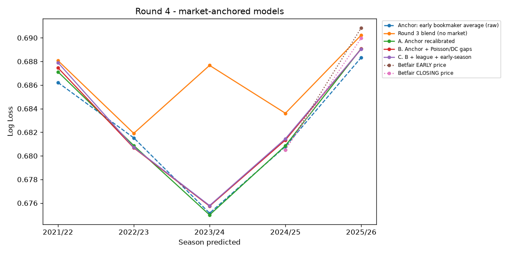

# R&D round 4 - market-anchored model

Start from the early bookmaker-average price (Football-Data `Avg>2.5`, margin removed) and let a logistic regression learn corrections from out-of-sample Poisson and rolling Dixon-Coles predictions (as gaps from the price), league and early-season. Walk-forward over 5 folds (2021/22 - 2025/26), training only on seasons with odds (2019/20+).

## Walk-forward (5 folds)

| candidate | mean_log_loss | std_log_loss | mean_brier | n_folds | folds_beating_anchor |
|---|---|---|---|---|---|
| Anchor: early bookmaker average (raw) | 0.6824 | 0.0051 | 0.2447 | 5 |  |
| A. Anchor recalibrated | 0.6826 | 0.0056 | 0.2448 | 5 | 2.0000 |
| B. Anchor + Poisson/DC gaps | 0.6829 | 0.0054 | 0.2449 | 5 | 1.0000 |
| C. B + league + early-season | 0.6830 | 0.0055 | 0.2450 | 5 | 1.0000 |
| Round 3 blend (no market) | 0.6863 | 0.0034 | 0.2466 | 5 | 0.0000 |

## The honest test - vs Betfair CLOSING price (2024/25 + 2025/26 pooled)

`diff_vs_close` = mean per-match log loss minus Betfair close's; negative = better. 95% bootstrap interval in `ci_low` / `ci_high`.

| candidate | log_loss | betfair_close_log_loss | diff_vs_close | ci_low | ci_high | n |
|---|---|---|---|---|---|---|
| Anchor: early bookmaker average (raw) | 0.6851 | 0.6851 | -0.0000 | -0.0019 | 0.0019 | 3955 |
| Betfair EARLY price | 0.6854 | 0.6851 | 0.0003 | -0.0017 | 0.0024 | 3928 |
| A. Anchor recalibrated | 0.6856 | 0.6851 | 0.0004 | -0.0017 | 0.0025 | 3955 |
| B. Anchor + Poisson/DC gaps | 0.6858 | 0.6851 | 0.0007 | -0.0014 | 0.0026 | 3955 |
| C. B + league + early-season | 0.6858 | 0.6851 | 0.0007 | -0.0013 | 0.0027 | 3955 |
| Round 3 blend (no market) | 0.6870 | 0.6851 | 0.0019 | -0.0012 | 0.0048 | 3955 |

## Correction coefficients (model C, per fold)

| fold | x_anchor | x_pois_gap | x_dc_gap | early_season | league_Championship | league_League One | league_League Two |
|---|---|---|---|---|---|---|---|
| 2021/22 | 1.3563 | 0.2297 | 0.0074 | -0.0418 | 0.0818 | 0.1204 | 0.1191 |
| 2022/23 | 1.1842 | 0.0631 | 0.0614 | -0.0392 | 0.0439 | 0.0606 | 0.0590 |
| 2023/24 | 1.2659 | 0.1884 | 0.0809 | -0.0312 | 0.0565 | 0.0529 | 0.0526 |
| 2024/25 | 1.3421 | 0.1832 | -0.0241 | -0.0096 | 0.0460 | 0.0392 | 0.0644 |
| 2025/26 | 1.2482 | 0.0598 | 0.0031 | -0.0148 | 0.0347 | 0.0582 | 0.0489 |

**Best vs Betfair close: Anchor: early bookmaker average (raw)** - diff -0.0000 (95% CI -0.0019 to +0.0019). The interval includes or sits above zero - no demonstrated edge over the closing price.
