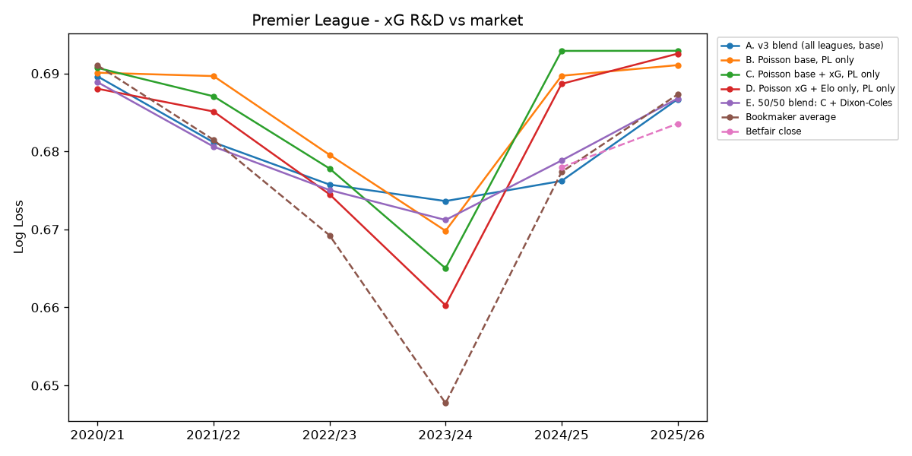

# Step 4 R&D - Understat xG, Premier League

23 leak-free xG features. 6-fold walk-forward (2020/21 - 2025/26), PL matches only.

## Per-season log loss

| season | n | A. v3 blend (all leagues, base) | B. Poisson base, PL only | C. Poisson base + xG, PL only | D. Poisson xG + Elo only, PL only | E. 50/50 blend: C + Dixon-Coles | Bookmaker average | Betfair close |
|---|---|---|---|---|---|---|---|---|
| 2020/21 | 380 | 0.6896 | 0.6901 | 0.6907 | 0.6880 | 0.6889 | 0.6910 |  |
| 2021/22 | 380 | 0.6812 | 0.6897 | 0.6871 | 0.6851 | 0.6806 | 0.6815 |  |
| 2022/23 | 380 | 0.6757 | 0.6796 | 0.6778 | 0.6745 | 0.6750 | 0.6692 |  |
| 2023/24 | 380 | 0.6736 | 0.6698 | 0.6650 | 0.6603 | 0.6712 | 0.6477 |  |
| 2024/25 | 380 | 0.6762 | 0.6897 | 0.6929 | 0.6887 | 0.6788 | 0.6774 | 0.6780 |
| 2025/26 | 380 | 0.6867 | 0.6911 | 0.6929 | 0.6925 | 0.6868 | 0.6873 | 0.6836 |

## vs Bookmaker average (diff < 0 = model better; 95% bootstrap interval)

| model | model_ll | market_ll | diff | ci_low | ci_high | seasons_beating_market | n |
|---|---|---|---|---|---|---|---|
| A. v3 blend (all leagues, base) | 0.6805 | 0.6757 | 0.0048 | 0.0010 | 0.0087 | 4/6 | 2280 |
| B. Poisson base, PL only | 0.6850 | 0.6757 | 0.0093 | 0.0048 | 0.0142 | 1/6 | 2280 |
| C. Poisson base + xG, PL only | 0.6844 | 0.6757 | 0.0087 | 0.0041 | 0.0139 | 1/6 | 2280 |
| D. Poisson xG + Elo only, PL only | 0.6815 | 0.6757 | 0.0058 | 0.0015 | 0.0106 | 1/6 | 2280 |
| E. 50/50 blend: C + Dixon-Coles | 0.6802 | 0.6757 | 0.0045 | 0.0002 | 0.0086 | 3/6 | 2280 |

## vs Betfair close (diff < 0 = model better; 95% bootstrap interval)

| model | model_ll | market_ll | diff | ci_low | ci_high | seasons_beating_market | n |
|---|---|---|---|---|---|---|---|
| A. v3 blend (all leagues, base) | 0.6814 | 0.6807 | 0.0007 | -0.0065 | 0.0080 | 1/2 | 738 |
| B. Poisson base, PL only | 0.6907 | 0.6807 | 0.0100 | 0.0012 | 0.0187 | 0/2 | 738 |
| C. Poisson base + xG, PL only | 0.6931 | 0.6807 | 0.0124 | 0.0027 | 0.0214 | 0/2 | 738 |
| D. Poisson xG + Elo only, PL only | 0.6912 | 0.6807 | 0.0105 | 0.0013 | 0.0198 | 0/2 | 738 |
| E. 50/50 blend: C + Dixon-Coles | 0.6827 | 0.6807 | 0.0020 | -0.0051 | 0.0090 | 0/2 | 738 |

**Effect of adding xG (C minus B): -0.0006** log loss (negative = xG helps).

